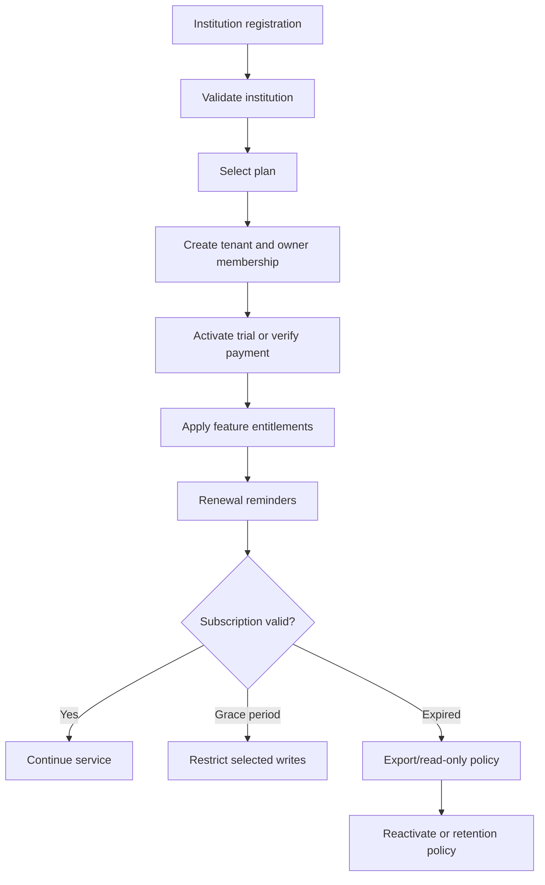
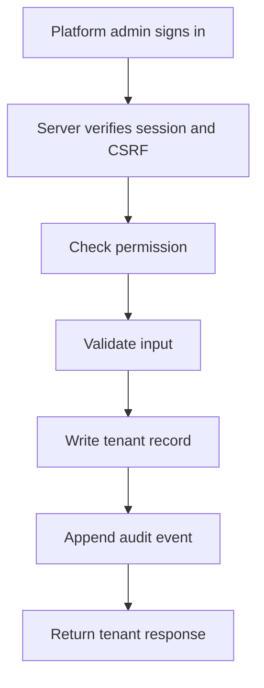

# EduSphere Pakistan — Phase 1 Foundation

A runnable development foundation for a multi-tenant school/college SaaS. The execution environment has Node.js 22 but no Composer, Docker or PostgreSQL client, so this starter uses Node.js built-in modules and a local JSON development store. A PostgreSQL schema foundation is included separately. This is not yet a production-ready school management platform.

## Run locally

Requirements: Node.js 22 or newer.

```bash
npm run seed
npm start
```

Open http://127.0.0.1:3000.

| Role | Email | Default demo password |
|---|---|---|
| Platform administrator | admin@edusphere.local | ChangeMe!2026 |
| Institution owner | owner@brightfuture.local | ChangeMe!2026 |

Change these demo passwords before sharing the app. For first-time seeding, you can set `DEMO_ADMIN_PASSWORD` and `DEMO_OWNER_PASSWORD` before running `npm run seed`. Seeding will not reset existing accounts. `PORT`, `HOST` and `DATA_DIR` can be configured through environment variables. Default host is loopback (`127.0.0.1`).

## Commands

```bash
npm run dev   # restart on source changes
npm test      # unit tests
npm run seed  # create demo data if absent
```

## Functional in this foundation

- Responsive, polished login and application shell.
- Password hashing using Node's `scrypt` and timing-safe password verification.
- HttpOnly/SameSite session cookie; eight-hour in-memory sessions; CSRF token required for mutating API requests.
- Basic per-process login throttling.
- Server-side role/permission checks for platform institution-management routes.
- Institution create, list, search, suspend and activate operations.
- Dashboard summaries filtered to the user's authorized tenant scope.
- Audit events for login/logout and tenant create/update.
- Audit trail screen and tenant-scoped log access.
- Basic security headers, request body limit, generic server errors.
- PostgreSQL schema foundation with foreign keys, constraints, indexes and sample RLS policies.

## API (`/api/v1`)

| Method | Route | Access |
|---|---|---|
| GET | `/health` | Public health check |
| POST | `/auth/login` | Public; throttled |
| GET | `/auth/me` | Authenticated |
| POST | `/auth/logout` | Authenticated + CSRF |
| GET | `/dashboard` | Authenticated; tenant-scoped |
| GET | `/tenants` | `tenants.view` |
| POST | `/tenants` | `tenants.create` |
| PATCH | `/tenants/:id` | `tenants.update` |
| GET | `/audit-logs` | `audit_logs.view`; tenant-scoped |

## Architecture and limitations

- Current runnable implementation: Node.js HTTP server, static frontend, JSON file store, in-memory session store. This was chosen because the environment lacks the preferred Laravel/PostgreSQL execution services.
- Target production architecture remains Next.js + TypeScript, Laravel REST API, PostgreSQL, Redis, private object storage and Docker.
- This JSON store is not concurrency-safe for production, sessions disappear on restart, and rate limits are process-local. Never expose the demo publicly or store real student data in it.
- The UI has planned-module navigation items, but admissions, students, attendance, finance, exams, payroll, notifications and parent/student portals are not implemented yet.
- Role permission definitions include future roles; most associated domain modules are not implemented.
- PostgreSQL migration has not been executed in this environment. Test it against a disposable PostgreSQL database before relying on it. RLS is defense-in-depth and requires a least-privileged app DB role and transaction-local `app.tenant_id` set from verified auth context. A DB superuser or `BYPASSRLS` role can bypass RLS.
- Production readiness still requires durable shared sessions, account recovery, MFA, email verification, stronger shared rate limiting, proper API schema/OpenAPI, migrations tooling, integration tests, monitoring, backup/restore drills, privacy and legal review, and security testing.

## PostgreSQL schema foundation

`migrations/001_phase1_postgresql.sql` creates tenants, campuses, users, memberships, roles, permissions, role assignments, plans, subscriptions, tenant settings and audit logs. Apply to a new database only after review. It is not wired into the Node demo server yet.

## Workflow diagrams

### Tenant and subscription lifecycle (planned)



### Implemented tenant administration subset



## Phase 1 status

- [x] Runnable application foundation and login
- [x] Demo seed script
- [x] Password hashing and permission helper tests
- [x] Basic session + CSRF pattern
- [x] Tenant-filtered dashboard/list and tenant create/status update
- [x] Audit trail
- [x] PostgreSQL Phase 1 schema draft
- [ ] PostgreSQL repository integration and executed migration
- [ ] Full tenant isolation integration tests against PostgreSQL/RLS
- [ ] Campus, membership and role-assignment workflows
- [ ] Persistent sessions, MFA, account recovery and invitation workflows
- [ ] OpenAPI specification and endpoint integration tests
- [ ] Docker deployment and production observability
- [ ] Student/admissions and later education modules

## Recommended next step

Replace the JSON store with PostgreSQL repository/service layers, add membership and campus CRUD, and run integration tests proving that cross-tenant reads and writes fail before implementing Phase 2 admissions and student records.

## Phase 2 development modules (demo foundation)

This update adds a basic, testable institution workflow:

- Platform admin creates an institution and its first owner account in one form.
- Platform admin can set up/update an owner account for an existing institution, or reset its password. The application never displays or retrieves an existing password; set a new password instead. Resetting invalidates the owner's active sessions.
- Institution owner can create classes/sections and academic years.
- Admission register: add students with admission number, father/guardian, class, date of birth and guardian phone.
- Class-wise attendance: mark present, absent, late or leave by date and save the class register.
- Marksheets foundation: record exam, subject, obtained marks and total marks; percentages are calculated and shown in the results table.
- Fee receipt generator: record a fee payment and print a receipt.
- Student admit-card generator: print an admission/admit-card document from a student record.
- Tenant scoping is applied to school-module API queries and mutations.

### Important limitations

This remains a development prototype using a local JSON file, not production storage. Do not expose it to the internet or use it for real student data. PostgreSQL migration is still not connected to the app. Before real deployment, implement and test PostgreSQL transactions, tenant isolation/RLS, role-specific permissions, backups, password reset audit/notification flow, CSRF/session hardening, input validation, automated integration tests, PDF generation, academic grading rules, fee ledgers/refunds, and privacy/retention controls. The current receipt generator records a payment entry but does not process bank/mobile-wallet payments. The print-ready documents are browser-print layouts, not official board-issued documents.

### Updating an existing local installation

1. Stop the server with `Ctrl+C`.
2. Back up `data/store.json` somewhere safe.
3. Copy the updated `src`, `public`, `migrations`, `tests`, `package.json`, and `README.md` into your existing project, replacing the old versions. **Do not overwrite your existing `data/store.json`** because it contains your created institution records.
4. In PowerShell, run `npm.cmd test`, then `npm.cmd start`.
5. Sign in as platform admin, open Institutions, and use **Set up / update owner** for the institution you already created. Enter the owner name, login email and a password of at least 10 characters.
6. Sign out and log in with the new owner credentials. Open **Classes & students** to create classes, register students, take attendance, record marks and generate receipts/admit cards.


## Phase 3 additions (development prototype)

- Institution dashboard uses four consistent cards: total students, present today, absent today, and fee receipts recorded this month. Present/absent cards open a searchable, class-filtered student list for the selected day.
- Attendance has Daily Attendance and Monthly Attendance Report views. Monthly reports summarize attendance records by class and list each recorded student/date/status, with a print option. Dates with no saved record remain unmarked rather than being treated as absent.
- Finance & Salaries includes a staff register with monthly salary, a salary payment form, salary payment history, and a monthly overview based on recorded fee receipts and payroll payments.
- Staff and salary endpoints are restricted to the institution-owner role and tenant-scoped. The prototype prevents a second salary payment record for the same staff member/month. It currently supports one payment record per staff/month; instalments, reversals, payslip generation, expenses, fee balances, and advanced permissions need further work.

**Important:** This remains a local development prototype using JSON storage. Do not use it for real student or payroll data or expose it publicly until database persistence, backups, production authentication/session handling, access controls, and security review are completed.


## Phase 4 dashboard and attendance improvements

This version adds a visible **Mark Attendance** shortcut in the institution sidebar and a dashboard Quick Actions panel for Mark Attendance, Add Student, Collect Fee, and Pay Salary. The four institution KPI cards retain the same card styling. Daily attendance now preloads statuses already saved for the selected class/date and includes Mark All Present / Mark All Absent controls. The monthly attendance report includes a student-by-date calendar, unmarked dates, print support, and CSV export. Date defaults and dashboard attendance queries use the Asia/Karachi local date.

### Updating an existing local project

1. Stop the running server with Ctrl+C. Back up the entire project folder, especially `data/store.json`.
2. Extract this ZIP to a separate folder first.
3. Copy the contents of the extracted `edusphere-pakistan` folder into the existing project folder and allow code files to be replaced. **Do not overwrite your existing `data/store.json`** if it contains your school records.
4. In the existing project terminal run `npm.cmd install` if dependencies are needed, then `npm.cmd start`. Do not run the seed command against your existing data.
5. Hard-refresh the browser with Ctrl+Shift+R.

This remains a development prototype. Back up records before upgrades and do not use it for production or real student data until database durability, tenant isolation, backups, and comprehensive workflow/security testing are completed.


## Phase 5: institution heading, greeting and fee vouchers

- **Institution name and greeting.** The institution dashboard now shows the institution's name (the one the platform admin typed when creating it, or later edited) as the page heading, with a time-based greeting and the signed-in user's name underneath: "Good morning" 05:00-11:59, "Good afternoon" 12:00-16:59, "Good evening" otherwise (Asia/Karachi time). The name also appears in the sidebar, the browser tab title and on printed receipts/admit cards. Platform admins see the greeting as the heading.
- **Fee vouchers** (School management > Fee vouchers, or the Submit Voucher quick action). Record voucher/challan number, student, fee month, amount, payment method, bank/wallet, reference number, payment date and notes, and attach up to 3 photos or PDFs (JPG, PNG, WebP, PDF; 2 MB each). Photos are shrunk in the browser to 1600px JPEG before upload. Vouchers start as *pending* and the owner can mark them *verified* or *rejected* once.
- **Upload safety.** File type is decided from the file's contents, not its name or declared type. Files are stored under `data/uploads/<institution>/` outside the public folder and are only served through an authenticated, institution-scoped endpoint with `nosniff`; PDFs are downloaded rather than displayed. Voucher numbers are unique per institution.
- **Also changed:** API requests are now processed one at a time (fixes lost updates when several requests arrived together); request bodies are read as raw bytes (fixes corrupted Urdu text at chunk boundaries); dashboard "today" and "this month" use Asia/Karachi; print windows work under the Content-Security-Policy (`print.css`, `print.js`).
- **Limits:** a verified voucher does not yet create a fee receipt or count toward "Fee Collected"; vouchers can't be edited or deleted; only the institution owner can submit. Uploaded files live on local disk, so back up `data/uploads/` together with `store.json`.
- Run `npm test` (now includes API tests for vouchers and tenant isolation).


## Phase 6: fees, staff logins, parent portal, new dashboards

**Status:** server and screens are built and covered by `npm test` (28 tests).

What is included:
- **Dashboards:** institution (institute name heading, time-based greeting, attendance today, fee collection trend, absentees with Call/WhatsApp links, alerts, students per class, recent activity) and platform admin (KPIs, institutions with trial/last-active, attention list, growth, activity).
- **Fee management:** fee structure per class, monthly challan generation, partial payments, late fines, discounts and sibling detection, defaulters, printable challans and receipts; verified fee vouchers record the payment.
- **Staff logins:** owner, principal (read-only), teacher (assigned classes only), accountant (fees and vouchers).
- **Parent portal:** attendance, fee balance and results for linked children only.
- **CSV import** of students (with dry run and per-row errors), **result cards** (printable), **WhatsApp reminder links** (wa.me; no SMS gateway).
- **Security fixes:** suspension blocks users immediately, login throttling, sequential receipt/challan numbers, date/amount validation, per-institution audit trail.

Known limitations:
- Urdu/RTL covers navigation, greeting, dashboards and quick actions only; other screens remain English.
- WhatsApp is a link that opens the app; no automatic SMS/WhatsApp sending.
- No online payment gateway or platform billing/MRR.
- Import is CSV only (save Excel files as CSV).
- Storage is still a JSON file; move to a real database (e.g. PostgreSQL) before real production use.
